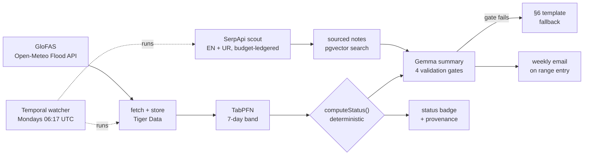
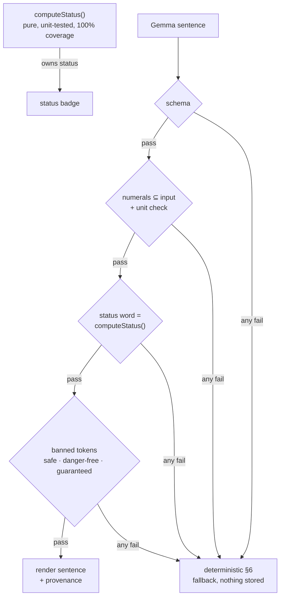

# PaddleSense — when can I paddle?

[](https://github.com/abubakar-ahmed-dev/paddle-sense/actions/workflows/ci.yml)


**A river-level watcher for Pakistan's paddling waters** — kayak, raft, SUP.
PaddleSense watches river discharge from free public data, predicts next
week's flow band, scouts access notes and closures in English and Urdu, and
renders one conservative plain-language status per river — with the source
and date attached to every number.

**Live: [paddle-sense.onrender.com](https://paddle-sense.onrender.com)** (free tier — first load after a nap takes ~30 s)

> **Judges — submission snapshot:** the challenge submission is frozen at
> [`4546248`](https://github.com/abubakar-ahmed-dev/paddle-sense/tree/45462487f25825e571bfb4a401f71f55da42dc68).
> Commits after that date are deployment hardening only (the Render credits
> arrived after the deadline, which let us ship the background worker) — no
> product behavior changed. Review either; they tell the same story.

**How each partner technology is used, with proof: [docs/TECHNOLOGIES.md](docs/TECHNOLOGIES.md)**


## The problem

Paddlers need river flow inside a runnable range: too low means dragging
over rocks, too high means danger. Today they read raw hydrology numbers —
or nothing at all — and guess. No tool watches, predicts, and translates
Pakistan's rivers into a go / wait / do-not-go answer. The data exists —
Copernicus GloFAS simulates every river on Earth — but it speaks to flood
forecasters, not to someone with a kayak on the roof.

## The pipeline



Every Monday the watcher executes the whole chain — and every step is
idempotent, so a crash mid-cycle costs nothing: the next boot finishes the
job with **zero duplicate rows** (proven by workflow tests that kill
activities mid-run on purpose).

## The safety model — the model never decides



The LLM translates; it never decides. Four runtime gates stand between a
model response and the screen — and the adversarial eval suite
([36 cases](docs/TECHNOLOGIES.md#3-gemma--a-language-model-on-a-leash))
catches invented numbers, unit relabels, softened danger, and banned words
every time.

| Dashboard | River detail | Retrodiction |
|---|---|---|
|  |  |  |

The [About page](public/images/about-page.jpg) explains grid cells, range
verification, and everything the app refuses to claim.

## Data honesty (the point)

- **No green "safe" exists anywhere** — in-range is calm water-blue; high
  water always says **do not go**. The ban is executable: a Playwright
  sweep crawls every route and fails on banned words.
- GloFAS values are **grid-cell estimates, not gauges** — every card shows
  cell coordinates, elevation, and fetch date.
- Every number carries its source; every chart is dated; unknown states
  render *"not yet verified"* — never blank, never guessed.
- **Ranges are never invented**: the database itself refuses a verified
  range without a linked, quoted source (`rivers_verified_complete`).
  Today: **Indus 55–120 m³/s, Kunhar 35–135 m³/s** owner-verified; Swat
  honestly unverified.
- Malir stays in the index as `not_a_paddling_river` — the app says "no"
  when the data says no.

## Tech stack

| Layer | Tech |
|---|---|
| App | Next.js 16 (App Router, PPR), TypeScript strict, Tailwind, Recharts |
| Data | Tiger Data — Postgres + pgvector (17k+ readings, HNSW note search) |
| Prediction | FastAPI + TabPFN 2.x (CPU-only), empirical-residual bands |
| Search | SerpApi (English + Urdu), budget-ledgered at 90/month |
| Language | Hosted open-weight Gemma, provider-swappable via one env var |
| Orchestration | Temporal (dev/tests) · worker-internal durable loop (prod) |
| Embeddings | all-MiniLM-L6-v2, local via transformers.js — no API key |
| Email | Resend (transition-into-range only, deterministic body) |
| QA | Vitest + Playwright + axe-core + Temporal test framework, CI on GitHub Actions |
| Hosting | Render — web, predict, and background worker |

Details and per-technology evidence: **[docs/TECHNOLOGIES.md](docs/TECHNOLOGIES.md)**

## Quality gates

| Gate | Result |
|---|---|
| Unit + eval + workflow tests | 121 passing (workflow tests kill activities mid-run) |
| DB invariants (throwaway pgvector Postgres) | 37 passing |
| Prediction contract (pytest) | 31 passing |
| E2E smoke + honesty sweep + axe a11y | 29 passing, zero axe violations |
| Backtest band coverage (published) | 82–96% vs 70% gate |
| Free-tier audit (`npm run cost-audit`) | exit 0 — all ceilings green |
| LLM adversarial eval | 36/36 caught or rendered honestly |

## Run it locally

```bash
npm install
npm run dev          # web app — http://localhost:3000 (live GloFAS needs no key)
npm run verify       # lint + tests + build (definition of done)
```

Full stack — see [.env.example](.env.example) for the keys each piece needs:

```bash
# prediction service (Python 3.13, CPU-only)
cd services/predict && python -m venv .venv && .venv/Scripts/pip install -r requirements.txt
.venv/Scripts/python -m uvicorn app:app --port 8000

# database (Tiger Data free tier or any Postgres with pgvector)
npm run db:migrate && npm run db:seed && npm run backfill

# weekly watcher
npm run start:worker                  # Temporal path (dev server on :7233)
WORKER_MODE=loop npm run start:worker # production durable loop
```

## Docs

Full index: [docs/README.md](docs/README.md). Highlights:
[Technologies & evidence](docs/TECHNOLOGIES.md) ·
[PRD](docs/PRD.md) · [architecture + ADRs](docs/TECHNICAL_ARCHITECTURE.md) ·
[data dictionary](docs/DATA_DICTIONARY.md) · [API contract](docs/API.md) ·
[testing](docs/TESTING.md) · [QA report](docs/qa-report.md) ·
[published backtest metrics](docs/retro-metrics.md) ·
[cost audit](docs/cost-audit.md) · [runbook](docs/RUNBOOK.md) ·
[deployment](docs/DEPLOYMENT.md)

## Branching

- `main` — stable, auto-deployed to Render
- `dev` — integration branch
- `phase/<n>-<name>` / `fix/*` — merged into `dev` via PR only

## Credits & disclaimer

- [Open-Meteo Flood API](https://open-meteo.com/en/docs/flood-api) —
  Copernicus GloFAS / ECMWF, free for non-commercial use
- River cells validated against the Jul–Sep 2022 monsoon record
  ([research record](docs/deep-dive.md))

**This is not a safety service.** Grid-cell model estimates are not gauge
readings. Always confirm with local sources before going on the water.
