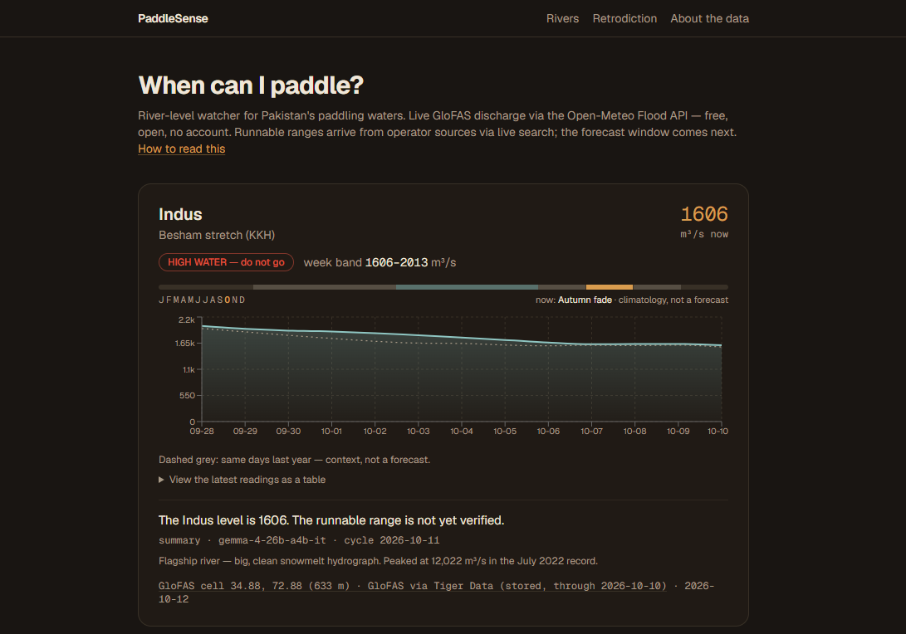
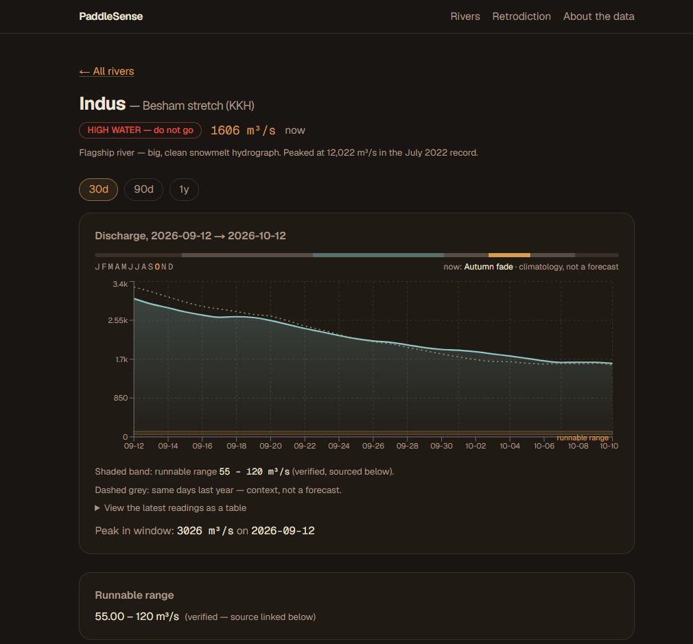
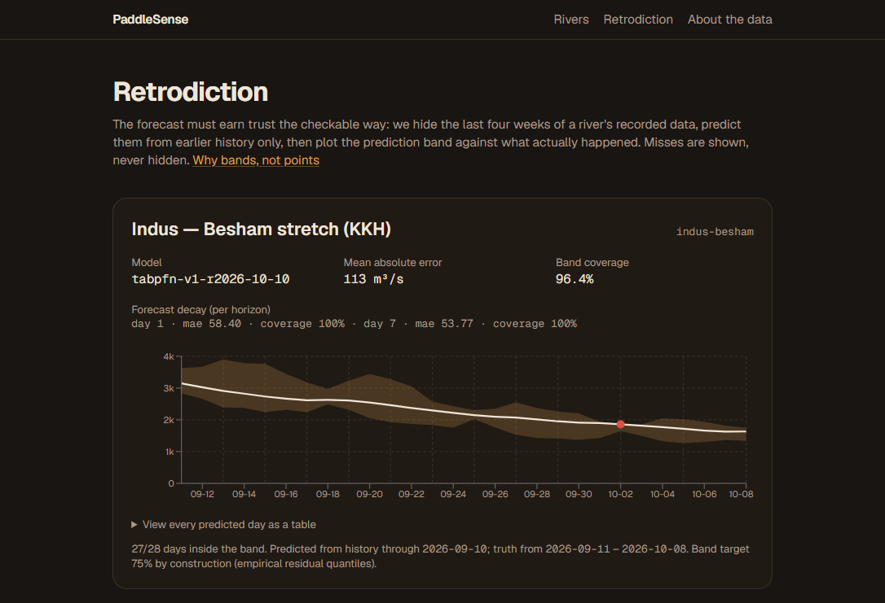

# PaddleSense — when can I paddle?

[](https://github.com/abubakar-ahmed-dev/paddle-sense/actions/workflows/ci.yml)

**A river-level watcher for Pakistan's paddling waters** — kayak, raft, SUP.
PaddleSense watches river discharge from free public data, predicts next
week's flow band, scouts access notes and closures, and renders one
conservative plain-language status per river — with the source and date
always attached.



## The problem

Paddlers need river flow inside a runnable range: too low means dragging
over rocks, too high means danger. Today they read raw hydrology numbers —
or nothing at all — and guess. No tool watches, predicts, and translates
Pakistan's rivers into a go / wait / do-not-go answer.

## What it does

- **Watches 4 rivers** (Indus at Besham, Kunhar at Balakot, Swat at Mingora,
  and the Malir as a deliberate honesty check) via the free
  [Open-Meteo Flood API](https://open-meteo.com/en/docs/flood-api)
  (Copernicus GloFAS v4)
- **Predicts a 7-day flow band** per river with TabPFN, and proves the
  forecast by retrodiction — hiding past weeks, predicting them, publishing
  every miss
- **Scouts the web weekly** (SerpApi) for access notes, closures, and
  runnable-range quotes in English and Urdu — every claim stored with its
  verbatim quote, source URL, and date
- **Explains each river in one sentence** (hosted open-weight Gemma),
  validated at runtime: the model may only use numbers we gave it and can
  never decide the safety status
- **Emails you when a river enters its verified runnable range** — the
  watcher runs itself weekly, survives kills, and never double-sends

| Dashboard | River detail | Retrodiction |
|---|---|---|
|  |  |  |

The [About page](public/images/about-page.jpg) explains grid cells, range
verification, and everything the app refuses to claim.

## How it works

```
GloFAS (Open-Meteo) ──▶ fetch+store ──▶ TabPFN band ──▶ status
        │                    │                             ▲
        │                    ▼                             │
        │             Tiger Data (Postgres      deterministic computeStatus()
        │             + pgvector notes)                   │
        ▼                                                 ▼
   SerpApi scout ──▶ sourced notes ──▶ Gemma summary ──▶ 4-gate validation
                                                          │ fail → §6 template
Weekly watcher (Temporal dev · in-process loop prod) ─────┘
                                                          ▼
                                            email when a river enters range
```

1. **Fetch** — daily discharge per GloFAS grid cell; cells were chosen by
   sweeping ~40 candidates and validating against the Jul–Sep 2022 monsoon
   record (Indus peaked at 12,022 m³/s; our cell reads 12,021.64).
2. **Predict** — a stateless FastAPI service wraps
   [TabPFN](https://github.com/PriorLabs/TabPFN) (CPU-only): the next 7 days
   as an empirical-residual **band**, never a single number. Backtest
   metrics are [published](docs/retro-metrics.md), misses included.
3. **Scout** — SerpApi searches (budget-capped at 90/month, cached) collect
   access notes and range candidates. Ranges stay *"not yet verified"*
   until a human promotes a quoted source — verified ranges carry
   provenance end-to-end.
4. **Summarize** — hosted Gemma writes one sentence per river. Four runtime
   gates: schema → every numeral must exist in the input → status word must
   equal `computeStatus()` → banned tokens (safe, danger-free, guaranteed).
   Any failure falls back to a deterministic template. Summaries are cached
   per cycle; no LLM call ever sits in the request path.
5. **Watch** — a weekly cycle runs the whole pipeline with per-river error
   isolation, retries, and idempotent double-runs. Temporal orchestrates in
   dev/tests; production runs the same activities in a worker-internal
   durable loop (measured ADR in
   [TECHNICAL_ARCHITECTURE §6 D5](docs/TECHNICAL_ARCHITECTURE.md)).

## Data honesty (the point)

- **No green "safe" exists anywhere.** In-range renders in calm water-blue;
  high water always says **do not go**.
- GloFAS values are **grid-cell estimates, not gauges** — every card shows
  its cell coordinates, elevation, and fetch date.
- Every number carries its source; every chart is dated; unknown states
  render *"not yet verified"* — never blank, never guessed.
- The model summarizes; it never decides status. Its output is validated
  before use and recorded when it fails.
- Malir (Karachi) stays in the index as `not_a_paddling_river` — the
  honesty check that proves the app says "no" when the data says no.

## Tech stack

| Layer | Tech |
|---|---|
| App | Next.js 16 (App Router, PPR), TypeScript, Tailwind, Recharts |
| Data | Tiger Data — Postgres + pgvector (17k+ readings, HNSW note search) |
| Prediction | FastAPI + TabPFN 2.x (CPU), empirical-residual bands |
| Search | SerpApi (gl=pk, English + Urdu), budget-ledgered |
| Language | Hosted Gemma (open-weight, provider-swappable via one env) |
| Orchestration | Temporal (dev/tests) · worker-internal durable loop (prod) |
| Embeddings | all-MiniLM-L6-v2, local via transformers.js — no API key |
| Email | Resend (transition-into-range only) |
| QA | Vitest + Playwright + axe-core + Temporal test framework, CI on GitHub Actions |
| Hosting | Render (free tier) |

Everything runs on free tiers — [$0 to run, audited](docs/cost-audit.md)
(`npm run cost-audit` exits non-zero if any ceiling is crossed).

## Run it locally

```bash
npm install
npm run dev          # web app — http://localhost:3000 (live GloFAS needs no key)
npm run build        # production build check
npm run verify       # lint + tests + build (definition of done)
```

Full stack (prediction + watcher) — see
[.env.example](.env.example) for the keys each piece needs:

```bash
# prediction service (Python 3.13, CPU-only)
cd services/predict && python -m venv .venv && .venv/Scripts/pip install -r requirements.txt
.venv/Scripts/python -m uvicorn app:app --port 8000

# database (Tiger Data free tier or any Postgres with pgvector)
npm run db:migrate && npm run db:seed && npm run backfill

# weekly watcher
npm run start:worker                  # Temporal path (dev server on :7233)
WORKER_MODE=loop npm run start:worker # production durable loop
```

Tests:

```bash
npm test              # unit + eval + workflow suites
npm run test:db       # DB invariants against a throwaway pgvector Postgres
npm run test:e2e      # Playwright: smoke + honesty sweep + axe a11y audit
npm run cost-audit    # free-tier usage vs ceilings
```

## Status

Active development for the DEV Hacktoberfest 2026 challenge ("Touch Grass").
Phases 0–8 complete ([plan](plans/plan.md)): data validation, UI,
persistence, prediction, search, LLM layer, durable watcher, QA gate.
Phase 9 (Render deploy) and 10 (write-up) in progress.

Verified runnable ranges (human-promoted, sourced): **Indus 55–120 m³/s**,
**Kunhar 35–135 m³/s**. Swat remains honestly *not yet verified*.

## Docs

Full index: [docs/README.md](docs/README.md). Highlights:
[PRD](docs/PRD.md) · [architecture + ADRs](docs/TECHNICAL_ARCHITECTURE.md) ·
[data dictionary](docs/DATA_DICTIONARY.md) · [API contract](docs/API.md) ·
[UX spec](docs/UX_SPEC.md) · [testing](docs/TESTING.md) ·
[QA report](docs/qa-report.md) · [runbook](docs/RUNBOOK.md) ·
[deployment](docs/DEPLOYMENT.md) · [cost audit](docs/cost-audit.md)

## Branching

- `main` — stable, published
- `dev` — integration branch (default)
- `phase/<n>-<name>` / `fix/*` — merged into `dev` via PR only

## Credits & disclaimer

- [Open-Meteo Flood API](https://open-meteo.com/en/docs/flood-api) —
  Copernicus GloFAS / ECMWF, free for non-commercial use
- River cells validated against the Jul–Sep 2022 monsoon record
  ([research record](docs/deep-dive.md))

**This is not a safety service.** Grid-cell model estimates are not gauge
readings. Always confirm with local sources before going on the water.
